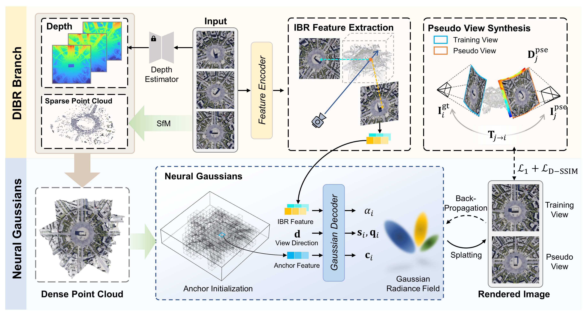

# DIR-GS: DIBR Guided Neural Gaussian for Remote Sensing Sparse View Synthesis 

This is the official repository for **DIR-GS: DIBR Guided Neural Gaussian for Remote Sensing Sparse View Synthesis** 


## Overview
This project implements a sparse-view novel view synthesis framework based on monocular depth estimation and neural Gaussians.  
The approach leverages Depth Image-Based Rendering (DIBR) to generate pseudo-view images. By training across multiple scenes, it achieves high-quality renderings and provides evaluation metrics for the generated results.

## Installation

### Dependencies

- Linux or Windows
- Python 3.9+
- PyTorch 2.0 or higher
- CUDA 11.7 or higher
### Environment Setup

1. Clone this repo:
```bash
git clone https://github.com/kanehub/DIR-GS.git
cd DIR-GS
````


2. Create the conda environment:
```bash
conda env create --file environment.yml
conda activate dir_gs
```
## Data
1. Please download the [LEVIR-NVS](https://drive.google.com/drive/folders/1orEpAN-SLF0i7yFn_mrPVmtM12E2pcdj?usp=sharing) dataset, and put it in the ```data/``` folder. The path is organized as follows:
```
data
├──LEVIR_NVS
│     ├── scene_000                 
│     │   ├── Images       
│     │   ├── Cams    
│     │   ├── Depths            
│     │   └── Track            
│     ├── scene_001       
│     ├── scene_002                          
│     └── ... 
...
```

2. Prepare the dataset and generate COLMAP-style camera poses and sparse SfM point clouds:

```bash
bash scripts/prepare_colmap.sh
```

3. Perform monocular depth estimation and fuse the point clouds:

```bash
bash scripts/monodepth_initialize.sh
```

4. Generate pseudo view images:

```bash
bash scripts/generate_pseudo_views.sh
```

## Training and Evaluation

### Training
Train on all scenes, render images, and compute evaluation metrics:

```bash
bash scripts/train_all_scenes.sh
```


### Rendering

```bash
python render.py -m <path_to_trained_model>
```

### Metrics

```bash
python metrics.py -m <path_to_trained_model>
```

### Model Weights Download

You can download the pre-trained model weights from the [Google Drive](https://drive.google.com/file/d/1E8omueHhrk2VumsqcAG5uxcDN9mC58nK/view?usp=sharing)


## Acknowledgements
Many thanks to these great projects!

- [Gaussian-Splatting](https://github.com/graphdeco-inria/gaussian-splatting)
- [Scaffold-GS](https://github.com/city-super/Scaffold-GS)


